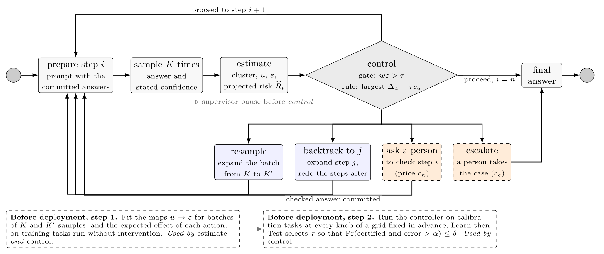
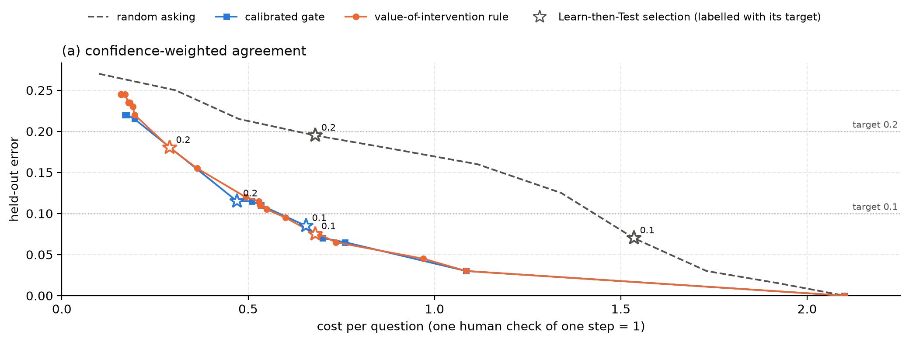

# ucagent

**When should a language-model agent stop and ask a person?** `ucagent` decides that at every step of a multi-step task, and tunes the decision so that the final answers are wrong at most as often as you allow.

## The problem

- **Errors compound.** An agent that gets each of five steps right 95% of the time gets the final answer right only 77% of the time.
- **A person's check costs time.** Checking every step is too expensive, and checking none is not acceptable.
- **Agent frameworks leave the rule open.** They provide the hook for a person in the loop, but they do not say when to use it.

## How it works

1. **Sample.** At each step the model answers several times, and each sample states its confidence.
2. **Estimate.** How much the samples agree becomes an estimated probability that the step is wrong, through a map fitted on training tasks.
3. **Decide.** A controller weighs that risk against the price of each action: proceed, sample again, backtrack, ask a person to check the step, or hand the whole case over.
4. **Calibrate.** Before deployment, Learn-then-Test picks the controller's single knob on calibration tasks, for the error target you choose. The guarantee is a finite-sample one and holds under the conditions stated in `docs/MATH.md`.



*The control loop of one task. The two actions in dashed orange involve a person. The two boxes below the loop are the calibration steps, done once before deployment.*

The loop is an explicit [LangGraph](https://github.com/langchain-ai/langgraph) graph with human interrupts, a supervisor mode in which a person sees every decision and can override it, and an audit log.

## One run, step by step

This command runs one five-step task on the built-in mock model and lets a simulated reviewer answer the checks:

```bash
uv run ucagent demo --policy marginal --knob 0.05 --auto
```

Its output, with the long reason of each decision cut off:

```
step 1: answer='Vorkaja Gardrilo' u=0.00 eps=0.00 source=llm
    -> proceed: marginal: proceed (no positive net value), ...
step 2: answer='Mija Rentas' u=0.40 eps=0.00 source=human
    -> ask_human: marginal: ask_human, delta=0.400 > tau*c=0.050, ...
step 3: answer='Murosdri Drinok' u=0.20 eps=0.00 source=human
    -> ask_human: marginal: ask_human, delta=0.200 > tau*c=0.050, ...
step 4: answer='Shamurmi Kaith' u=0.00 eps=0.00 source=llm
    -> proceed: marginal: proceed (no positive net value), ...
step 5: answer='Elosnok Kapel' u=0.00 eps=0.00 source=llm
    -> proceed: marginal: proceed (no positive net value), ...
final answer 'Elosnok Kapel' correct=True escalated=False cost=2.25
```

- **`u`** is the disagreement among the samples of a step. At steps 1, 4 and 5 they agreed, so the agent went on.
- **At steps 2 and 3** they disagreed. The expected drop in risk (`delta`) exceeded the knob times the price of a check (`tau*c`), so the agent asked, and the checked answer was committed (`source=human`).
- **`eps`** is the estimated probability that the committed answer is wrong; a checked answer counts as right.
- **The cost** is two checks at 1 each, plus 0.05 per step for sampling.

Without `--auto`, you answer the checks yourself in the terminal.

## What it buys



*Held-out error against the cost of oversight on 200 MuSiQue two-hop questions, with `gpt-oss:20b` and confidence-weighted agreement as the uncertainty score. One check of one step costs 1. Stars mark the points that Learn-then-Test selected, on 200 other questions, for the targets 0.2 and 0.1. The full caption is in `docs/figures/fig_results.caption.txt`.*

- **Without any check,** 27% of the final answers are wrong.
- **For a target of 10%,** the calibrated gate is selected at a cost of 0.66 per question, and 8.5% of the held-out answers are wrong. Random asking needs a cost of 1.53 for the same target.
- **Checking every step** costs 2.10.

These numbers come from one model, simulated reviewers and one seed; see the limits below.

## Use it on your own task

You supply up to three things. The loop, the calibration and the commands stay as they are.

- **A task:** your steps, prompts, answer parser and correctness labels (the `Task` protocol).
- **A reviewer:** any object with the two methods of `HumanInterface`, for example your review queue.
- **Optionally,** your own uncertainty estimator, calibrator or controller, registered by name from a plugin module.

`docs/ADOPTION.md` walks through `examples/toy_task.py`, an arithmetic chain of about 150 lines.

## Limits

- **Evaluation.** One open model (`gpt-oss:20b`), three benchmarks, simulated reviewers, and benchmark labels that contain defects.
- **The guarantee** assumes a pipeline fixed in advance and independent calibration tasks. It does not cover a person who overrides the controller.
- **Research code.** A fitted calibration file does not record which model it was fitted for, so do not reuse one across models.

## Install and try

```bash
pipx install uv      # once
make setup           # Python 3.11 or later; no API key needed
make test            # runs on a mock model, a few minutes
uv run ucagent demo --policy marginal --knob 0.05   # one task; you answer the step checks
make ui              # the same in a web page, with the supervisor mode
```

## What is where

This repository holds the framework, its tests, and the configurations and scripts of its evaluation on three benchmarks.

| Path | Contents |
|---|---|
| `src/ucagent/core/` | The framework: uncertainty estimators and their calibration (`uq/`), risk propagation (`risk/`), controllers and Learn-then-Test (`control/`), the graph and the human interface (`graph/`), model backends with a response cache (`llm/`) |
| `src/ucagent/tasks/` | The tasks: MuSiQue, 2WikiMultiHopQA, FinQA and a synthetic chain |
| `src/ucagent/experiments/`, `src/ucagent/ui/` | Running and calibrating suites of runs; the web page |
| `configs/` | The run configurations: model, prices, label rules, questions and knob grids |
| `scripts/` | The scripts that write the evaluation's tables, figures and counts from the run records |
| `docs/MATH.md`, `docs/DESIGN.md`, `docs/ADOPTION.md` | The math, the control loop, and how to plug in your own task (`examples/toy_task.py`) |
| `tests/` | The tests; they need no model server |

## The evaluation

- **Runs.** `uv run ucagent suite -c configs/<name>.yaml` runs every controller of a configuration over its knob grid, and `uv run ucagent calibrate -s results/<name>` selects the knobs with Learn-then-Test. The benchmark runs used `gpt-oss:20b` on an Ollama server.
- **Run records.** The run records and the cache of model replies are not in this repository; they are available from the author on request. With them, the scripts write their tables and figures again without a model call.
- **Data.** The datasets are not redistributed here. Shortened records serve as test fixtures (`tests/fixtures/README.md`).
  - MuSiQue (CC BY 4.0): `musique_ans_v1.0_train.jsonl` and `musique_ans_v1.0_dev.jsonl` go to `data/musique/`.
  - 2WikiMultiHopQA (Apache 2.0): `dev.parquet` of the Hugging Face mirror `xanhho/2WikiMultihopQA` goes to `data/twowiki/`; then run `uv run python scripts/prepare_twowiki.py data/twowiki/dev.parquet --out data/twowiki --exclude-ids configs/twowiki_smoked_ids.txt`.
  - FinQA (MIT): `train.json`, `dev.json` and `test.json` go to `data/finqa/`.
- **Development files.** Comments in some files name an experiment log, a decision log and review notes (`docs/EXPERIMENTS.md`, `docs/DECISIONS.md`, `docs/reviews/`). These are kept in the development repository and are available from the author on request. Some scripts and Makefile targets are named after a preprint that is not public yet.

## Citation and license

See `CITATION.cff`. MIT license.
