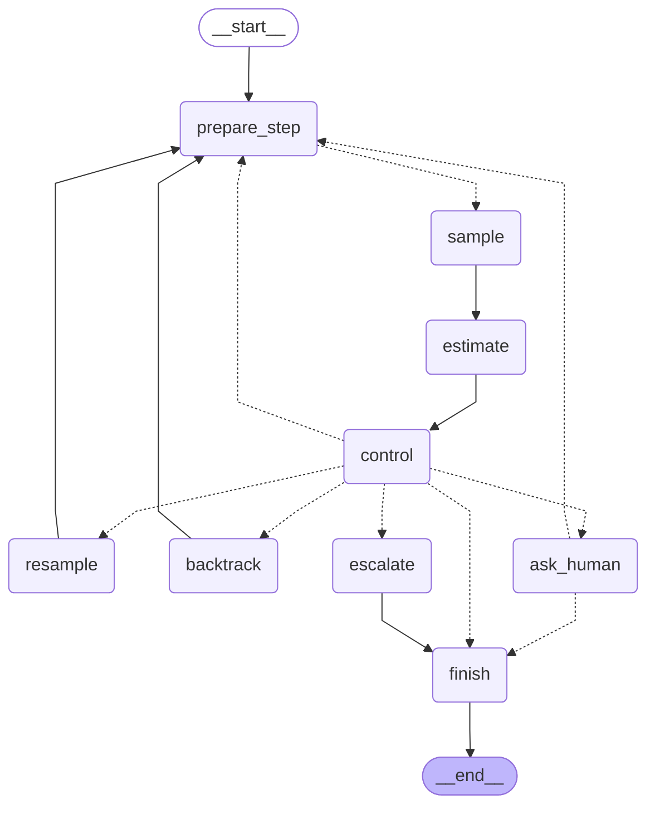

# Design

Architecture and data flow. The graph diagram below is generated from code by `scripts/export_graph.py` (`make docs`); do not edit it by hand.

## Packages

- `ucagent.core` — reusable library, no task-specific code (enforced by `tests/test_import_boundary.py`).
- `ucagent.tasks`, `ucagent.experiments` — research harness.
- `ucagent.api` — adopter-facing entry points.

## Control loop

<!-- BEGIN GRAPH -->

<!-- END GRAPH -->

## Pauses and overrides (interactive sessions)

`core/graph/session.py` drives the same compiled graph one pause at a time. Two pause kinds exist. A **static pause** comes from the per-call option `interrupt_before=["control"]` (supervisor mode): the graph has sampled and estimated the step and stops before the controller runs; `invoke` returns no `__interrupt__` entry and the pause shows up as `get_state(config).next == ("control",)`. A **dynamic pause** is an `interrupt()` raised by `ask_human` or `escalate`, whose payload (`kind: check_step | take_over`) is what the human answers. A human override of the controller travels through `RunSettings.force_decisions`, keyed `"step:attempt"` (the step's decision round, see below), in the `configurable` of exactly one call; `control` applies it instead of the policy's decision, records the policy's proposal next to it and flags the intervention with `numbers["override"] = 1`. The graph itself is unchanged: no node was added, and the audit record of an overridden run reads like any other.

## Decision rounds and draws

Two counters describe where a step stands (`core/graph/state.py`, 2026-11-08). The **draw** identifies the step's sample batch: it goes into the prompt header and into the samples key `"{step}:{draw}"`. A resample keeps the draw and expands the batch (the sample nodes append indices `K..K'-1` under the same key and the step is re-estimated through the map fitted for `K'`-sample batches); a backtrack keeps its target's draw for the same reason and gives the redone later steps fresh draws. The **attempt** is the decision round of the step (0, then 1 after a resample or a backtrack): it keys overrides, scripted decisions and pauses, so it must be unique per visit of `control`, and it is derived from the append-only `interventions` channel so that a backtrack cannot make it repeat. `core/graph/feasibility.py` holds the two rules both actions obey (an unused cap, and a batch still below `K'`); the policies, the interactive session and `control` all consult it, and `control` turns an infeasible forced or scripted resample or backtrack into `proceed` with `numbers["infeasible"] = 1` rather than letting the graph dead-end.
